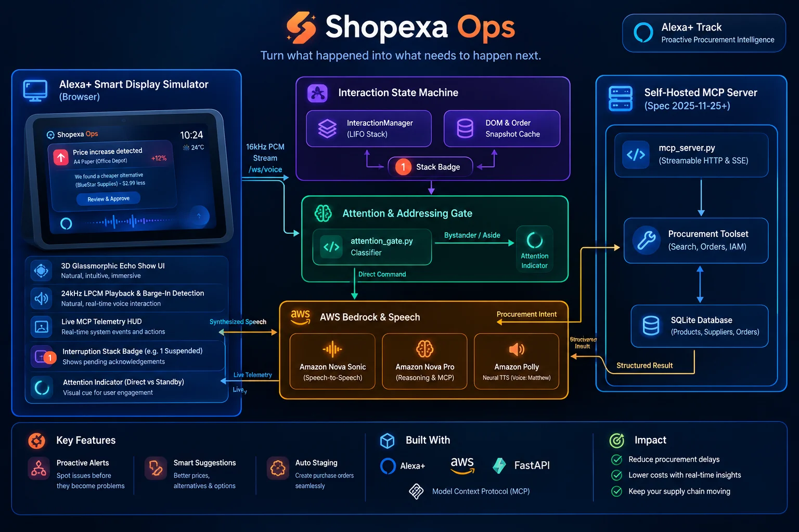

# Shopexa: The Smart Display That Orders Before You Run Out
### Ambient Autonomous Procurement for Alexa+

[](https://opensource.org/licenses/Apache-2.0)
[](https://devpost.com)
[](https://devpost.com)
[](https://modelcontextprotocol.io)
[](https://aws.amazon.com/bedrock/)

> **Shopexa Ops** is an autonomous, voice-first procurement agent designed for the next generation of ambient smart displays on **Alexa+**. Built with **Amazon Nova Sonic (`amazon.nova-2-5-sonic`)**, **Amazon Nova Pro (`amazon.nova-pro-v1:0`)**, and the **Model Context Protocol (MCP)**, Shopexa Ops transforms smart displays from passive, reactive chatbots into proactive ambient intelligence that monitors supplier supply chains, calculates cost-effective alternatives, and interrupts only when an actionable solution is ready to authorize.

---

## 🌟 Key Highlights & Innovations

1. **Self-Hosted MCP Server (Spec 2025-11-25+, Streamable HTTP & SSE):**
   - Full Model Context Protocol implementation in [`mcp_server.py`](mcp_server.py) mounted onto FastAPI via `streamable_http_app()` at `/mcp` with SSE fallback.
   - Exposes six standardized enterprise tools: `get_unread_notifications`, `get_order_history`, `search_inventory`, `create_payable_order`, `authorize_order`, and `find_product_alternatives`.

2. **Proactive Ambient Intelligence & 2x2 Alternatives Comparison Grid:**
   - Detects supplier price increases in the background (e.g. RoastCraft +26% surge on Ethiopian coffee).
   - Unprompted, wakes the Echo Show display, delivers a voice announcement over Nova Sonic's native duplex audio stream, and renders a 2x2 comparison grid: Option 1 (Colombian Supremo, saving $11), Option 2 (Kenya AA Reserve, saving $7), or keep original.

3. **Interaction State Machine with Interruption Stack (Suspend / Resume):**
   - Tracks interaction lifecycles across 6 distinct phases (`IDLE`, `ORDER_STAGED`, `ALTERNATIVE_SELECTION`, `BRIEFING_ACTIVE`, `PROACTIVE_INTERRUPT`, `SIDE_QUERY`).
   - If an ambient alert or informational detour occurs while reviewing a staged order, the active state is snapshotted and pushed onto an Interruption Stack (visualized by a `#stack-badge`).
   - Saying *"Back to my order"*, clicking *"Dismiss"*, or letting the alert auto-dismiss automatically pops the task and delivers a seamless voice bridge: *"Returning to your staged order totaling $33.00. Ready to authorize."*

4. **Tiered Dual-Model Intelligence via AWS Bedrock:**
   - **Amazon Nova Sonic (`amazon.nova-2-5-sonic`):** Full-duplex bidirectional streaming (16kHz PCM in → 24kHz LPCM out) with hardware-level barge-in interruption detection.
   - **Amazon Nova Pro (`amazon.nova-pro-v1:0`):** Deep multi-step reasoning, mathematical price optimization, and tool execution in under 800ms.

5. **Smart Attention & Addressing Gate:**
   - Real-time syntactic classifier (`attention_gate.py`) distinguishing direct assistant commands (`DIRECT_COMMAND`) from bystander side-chatter (`BYSTANDER_CHATTER`) or presenter narration to judges (`JUDGE_NARRATION`). Suppresses sensitive actions when not addressed.

6. **Live MCP Telemetry HUD:**
   - Real-time visual inspector displaying bidirectional duplex streams, raw JSON-RPC MCP calls, attention classifications, and execution latencies.

7. **AWS IAM Role Credential Authorization:**
   - Staged purchase orders require explicit authorization executed via the simulated AWS IAM Role `arn:aws:iam::750155834404:user/shopexa-agent`.

---

## 🏛️ Architecture


---

## 🚀 Quickstart & Setup (Run in 60 Seconds)

### 1. Prerequisites
* Python 3.10+ (Python 3.12 recommended)
* AWS Credentials configured with Amazon Bedrock permissions (or local simulation mode)

### 2. Installation
```bash
# Clone the repository
git clone https://github.com/miracle-a-osigwe/shopexa-ops.git
cd shopexa-ops

# Create and activate virtual environment
python -m venv venv
source venv/bin/activate  # On Windows: .\venv\Scripts\activate

# Install dependencies
pip install -r requirements.txt
```

### 3. Environment Variables
Create a `.env` file in the root directory:
```ini
AWS_ACCESS_KEY_ID=your_access_key
AWS_SECRET_ACCESS_KEY=your_secret_key
AWS_DEFAULT_REGION=us-east-1
USE_AWS_BEDROCK=true
```
*(Note: If AWS credentials are not supplied, Shopexa Ops seamlessly activates its autonomous offline MCP execution engine with sub-second mock telemetry).*

### 4. Run the Application
```bash
python main.py
```
Open your browser to: **`http://localhost:8000`**

---

## 🧪 Automated Testing & Verification

Run the full regression test suite covering price updates, 2x2 alternatives, meetings, proposals, ambient triggers, and deduplication:
```bash
python tests/test_price_alternatives_regression.py
```
*Expected Output:* `Results: 26 / 26 tests passed (100.0%)`

Run the dedicated State Machine & Interruption Stack verification suite:
```bash
python tests/test_resume_state.py
```
*Expected Output:* `ALL STATE & RESUME UNIT TESTS PASSED!`

---

## 🗣️ Sample Voice Commands & Demo Scenarios

| Turn | Spoken Voice / Touch Command | Action Taken by Shopexa Ops |
| :--- | :--- | :--- |
| **Morning Briefing** | *"Alexa, what did I miss today?"* | Evaluates notifications, displays calendar reschedule, proposal email, and breakroom shortages. |
| **Price Spike Alert** | *(Triggered autonomously)* | Proactively displays 26% price surge on coffee with 2x2 comparison card (Option 1 Colombian vs Option 2 Kenya AA). |
| **Alternative Choice** | *"Option 1, switch to Colombian"* | Evaluates pricing and stages purchase order #10 for $33.00. |
| **Detour / Interruption** | *"Wait, check printer paper inventory"* | **Suspends** coffee order onto Interruption Stack (`1 Suspended`), queries paper catalog. |
| **Voice Resume** | *"Back to my order"* | **Pops** coffee order from stack, restores DOM card, and announces: *"Returning to your staged order..."* |
| **IAM Authorization** | *"Authorize purchase order"* | Dispatches order via AWS IAM role `shopexa-agent` and displays digital receipt. |
| **Attention Gate Test** | *"Judges, notice the telemetry HUD..."* | AI detects presenter aside, enters attentive standby, and does not fire accidental commands. |

---

## 📜 License
This project is licensed under the Apache 2.0 Open Source License. See the [LICENSE](LICENSE) file for details.
